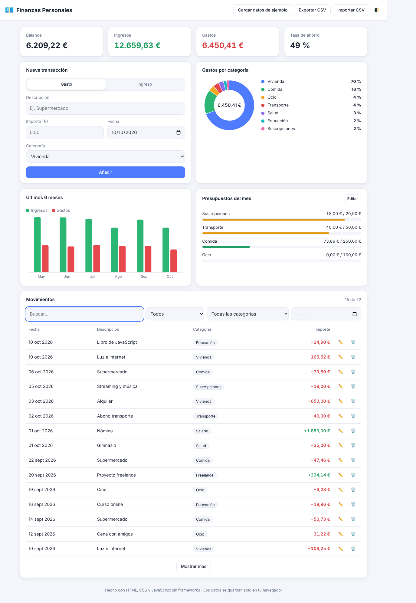
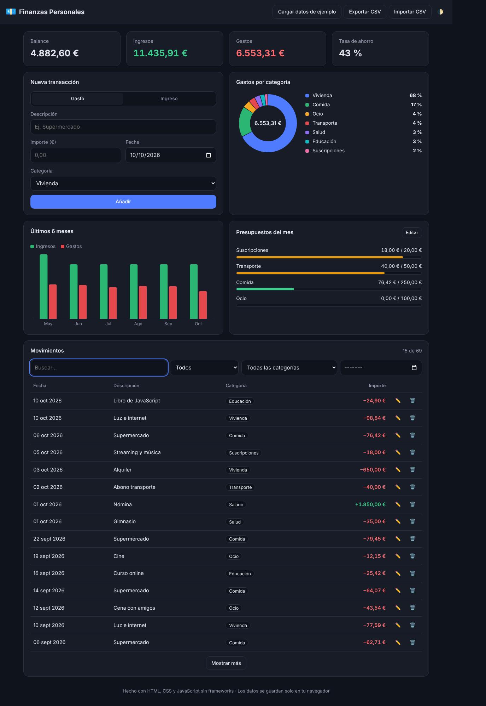
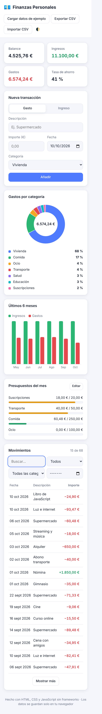

# 💶 Finanzas Personales

Aplicación web para gestionar finanzas personales: registra ingresos y gastos, fija presupuestos mensuales por categoría y visualiza tus datos con gráficos. Está hecha con **HTML, CSS y JavaScript puro (ES Modules)**, sin frameworks ni dependencias.

**🔗 Demo en vivo:** https://munguiagomezj.github.io/Proyecto1/ · pulsa *«Cargar datos de ejemplo»* para verla con datos.



<details>
<summary>Ver modo oscuro y versión móvil</summary>

| Modo oscuro | Móvil |
|---|---|
|  |  |

</details>

## ✨ Funcionalidades

- **CRUD de transacciones**: añadir, editar y eliminar ingresos y gastos, con validación de formulario.
- **Panel de resumen**: balance, ingresos, gastos y tasa de ahorro.
- **Gráficos propios con Canvas 2D**: dona de gastos por categoría y barras de los últimos 6 meses, sin librerías externas y nítidos en pantallas HiDPI.
- **Presupuestos mensuales** por categoría con barras de progreso y avisos al acercarse al límite o superarlo.
- **Búsqueda y filtros** por texto (sin distinguir tildes ni mayúsculas), tipo, categoría y mes, con paginación.
- **Importar y exportar CSV** con un parser propio compatible con RFC 4180 (comillas, comas y saltos de línea dentro de los campos). Las líneas inválidas se informan sin abortar la importación.
- **Persistencia en `localStorage`**: los datos no salen del navegador.
- **Modo claro/oscuro** (respeta la preferencia del sistema) y **diseño responsive**.
- **Accesibilidad**: HTML semántico, etiquetas ARIA, navegación por teclado y foco visible.

## 🧱 Arquitectura

```
├── index.html          # Estructura de la interfaz
├── src/
│   ├── finance.js      # Lógica de negocio pura (cálculos, filtros, validación)
│   ├── csv.js          # Importación/exportación CSV
│   ├── store.js        # Estado + persistencia (patrón observador)
│   ├── chart.js        # Gráficos con Canvas 2D
│   ├── demo.js         # Generador de datos de ejemplo
│   ├── app.js          # Capa de UI: eventos y renderizado
│   └── styles.css      # Estilos con variables CSS (temas)
└── tests/              # Tests unitarios con node:test
```

Decisiones técnicas:

- **Separación lógica / interfaz**: toda la lógica vive en funciones puras sin acceso al DOM (`finance.js`, `csv.js`), así se puede testear con Node sin navegador.
- **Importes en céntimos (enteros)** para evitar errores de coma flotante (`0.1 + 0.2 !== 0.3`).
- **Estado inmutable con suscriptores**: cada cambio pasa por el store, que guarda en `localStorage` y avisa a la UI para volver a pintar.
- **Seguridad**: todo el texto introducido por el usuario se escapa antes de insertarse en el HTML para evitar XSS.

## 🚀 Ejecutar en local

No hace falta instalar nada. Como usa ES Modules, hay que servirla por HTTP:

```bash
git clone https://github.com/munguiagomezj/Proyecto1.git
cd Proyecto1
npm start            # o: python3 -m http.server
```

Y abre la URL que aparece en la terminal.

## 🧪 Tests

```bash
npm test
```

Usa el test runner nativo de Node (≥ 18), sin dependencias. Los tests se ejecutan automáticamente en cada push con **GitHub Actions**, y la rama `main` se despliega en **GitHub Pages**.

## 🛣️ Posibles mejoras

- Transacciones recurrentes (alquiler, suscripciones).
- Varias monedas y cuentas.
- Sincronización con un backend y autenticación.
- PWA instalable con soporte offline.

## 📄 Licencia

[MIT](LICENSE)
